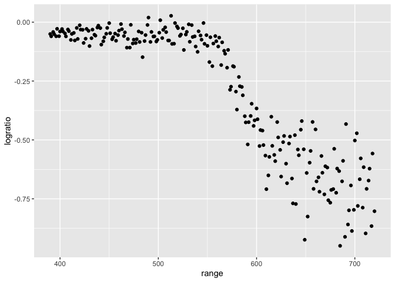
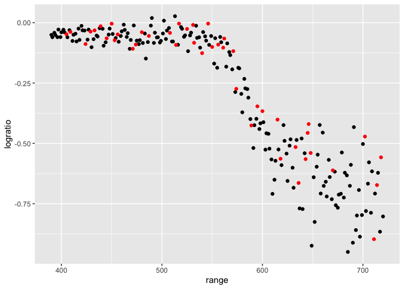
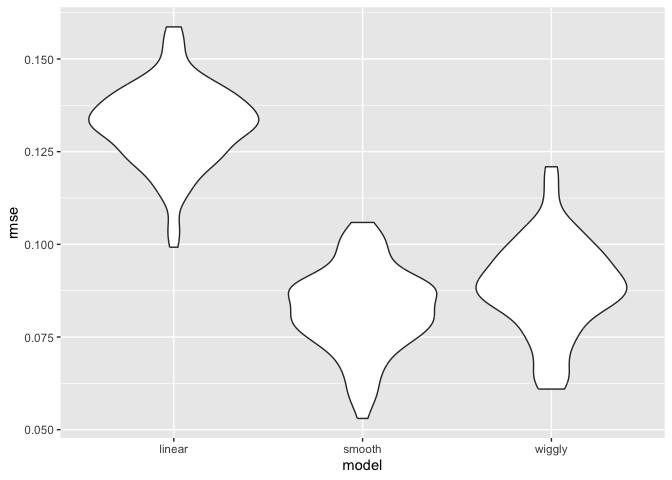
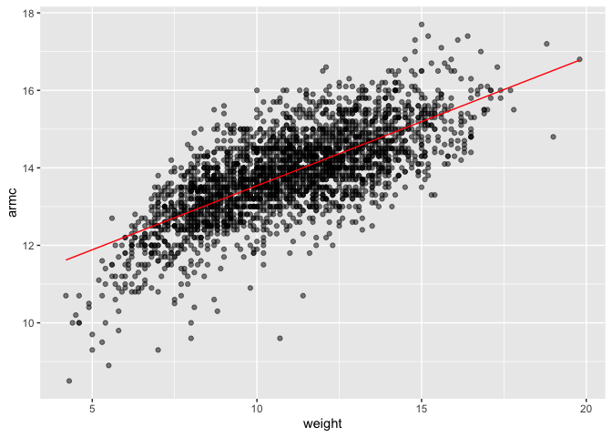
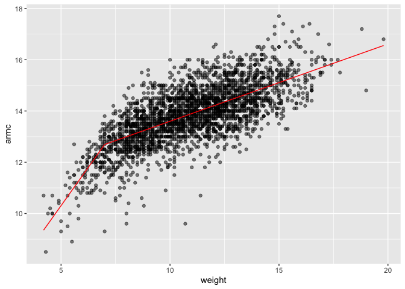

02_cross_validation
================
2026-11-17

``` r
library(tidyverse)
```

    ## ── Attaching core tidyverse packages ──────────────────────── tidyverse 2.0.0 ──
    ## ✔ dplyr     1.2.1     ✔ readr     2.2.0
    ## ✔ forcats   1.0.1     ✔ stringr   1.6.0
    ## ✔ ggplot2   4.0.3     ✔ tibble    3.3.1
    ## ✔ lubridate 1.9.5     ✔ tidyr     1.3.2
    ## ✔ purrr     1.2.2     
    ## ── Conflicts ────────────────────────────────────────── tidyverse_conflicts() ──
    ## ✖ dplyr::filter() masks stats::filter()
    ## ✖ dplyr::lag()    masks stats::lag()
    ## ℹ Use the conflicted package (<http://conflicted.r-lib.org/>) to force all conflicts to become errors

``` r
library(p8105.datasets)
library(modelr)          # add_predictions(), rmse(), crossv_mc()
library(mgcv)            # gam() for smooth, nonlinear models
```

    ## Loading required package: nlme
    ## 
    ## Attaching package: 'nlme'
    ## 
    ## The following object is masked from 'package:dplyr':
    ## 
    ##     collapse
    ## 
    ## This is mgcv 1.9-4. For overview type '?mgcv'.

## LIDAR Data

``` r
data("lidar")

lidar_df = 
  lidar |> 
  mutate(id = row_number()) |>             # give each row an id, so training and testing rows can be matched later
  select(id, everything())                 # move id to the first column

lidar_df |>                                # a clearly nonlinear relationship, which makes a good test case for comparing models
  ggplot(aes(x = range, y = logratio)) + 
  geom_point()
```

<!-- -->

Building Training and Testing Datasets

``` r
train_df = sample_frac(lidar_df, size = .8)           # random 80% of rows for training (newer equivalent: slice_sample(prop = .8))
test_df  = anti_join(lidar_df, train_df, by = "id")   # the remaining 20%: rows whose id is NOT in train_df
```

``` r
ggplot(train_df, aes(x = range, y = logratio)) +    # training data in black
  geom_point() + 
  geom_point(data = test_df, color = "red")         # testing data in red
```

<!-- -->

Fit Some Models

``` r
linear_mod = lm(logratio ~ range, data = train_df)                           # a straight line: too simple for this curve
smooth_mod = gam(logratio ~ s(range), data = train_df)                       # s() fits a smooth curve; gam() picks how smooth automatically
wiggly_mod = gam(logratio ~ s(range, k = 30), sp = 10e-6, data = train_df)   # k = 30 allows a very flexible curve and a tiny sp (smoothing
                                                                             # parameter) forces it to chase noise: deliberately overfit
```

Make a Plot

``` r
train_df |>
  add_predictions(linear_mod) |>               # adds a `pred` column with the model's prediction for each row
  ggplot(aes(x = range, y = logratio)) +
  geom_point() +
  geom_line(aes(y = pred), color = "red")      # red line connects the predictions (the fitted model)
```

<!-- -->

``` r
train_df |>
  add_predictions(smooth_mod) |>               # same plot for the smooth model, which follows the data's curve
  ggplot(aes(x = range, y = logratio)) +
  geom_point() +
  geom_line(aes(y = pred), color = "red")
```

<!-- -->

Do a Model Comparison

``` r
# RMSE (root mean squared error) on the TESTING data: how far predictions are from new
# observations, on average. Lower is better.
rmse(linear_mod, test_df)
```

    ## [1] 0.1338127

``` r
rmse(smooth_mod, test_df)
```

    ## [1] 0.08407828

``` r
rmse(wiggly_mod, test_df)
```

    ## [1] 0.1029337

## Repeat Multiple Times

Use Nice Tools

``` r
cv_df =
  crossv_mc(lidar_df, 100)   # 100 random 80/20 training/testing splits ("Monte Carlo" cross-validation)

cv_df |> pull(train) |> nth(2) |> as_tibble()    # inspect the 2nd training set. Splits are stored as "resample" objects (lists of row
```

    ## # A tibble: 176 × 3
    ##       id range logratio
    ##    <int> <dbl>    <dbl>
    ##  1     1   390  -0.0504
    ##  2     2   391  -0.0601
    ##  3     4   394  -0.0510
    ##  4     5   396  -0.0599
    ##  5     6   397  -0.0284
    ##  6     7   399  -0.0596
    ##  7     8   400  -0.0399
    ##  8     9   402  -0.0294
    ##  9    10   403  -0.0395
    ## 10    11   405  -0.0476
    ## # ℹ 166 more rows

``` r
                                                 # numbers, to save memory); as_tibble() turns one back into a regular dataframe
```

``` r
cv_df =
  crossv_mc(lidar_df, 100) |>
  mutate(
    train = map(train, as_tibble),   # convert every split to a tibble, since some model functions (like gam) don't accept resample objects
    test = map(test, as_tibble)
  )
```

Let’s Fit Models and Get RMSEs for These

``` r
# A small wrapper around rmse(). It isn't used below, since map2_dbl() calls rmse() directly
rmse_comp = function(model, dataset) {
  
  rmse(model, dataset)
  
}
```

``` r
cv_df = 
  cv_df |> 
  mutate(
    # fit each model to each of the 100 training sets; \(df) is shorthand for function(df)
    linear_fit = map(train, \(df) lm(logratio ~ range, data = df)),
    smooth_fit = map(train, \(df) gam(logratio ~ s(range), data = df)),
    wiggly_fit = map(train, \(df) gam(logratio ~ s(range, k = 30), sp = 10e-6, data = df))
  ) |> 
  mutate(
    # map2_dbl() pairs each model with its matching testing set and returns one RMSE (a number) per split
    rmse_linear = map2_dbl(linear_fit, test, rmse),
    rmse_smooth = map2_dbl(smooth_fit, test, rmse),
    rmse_wiggly = map2_dbl(wiggly_fit, test, rmse)
  )
```

Look at This

``` r
cv_df |>
  select(starts_with("rmse_")) |>   # keep only the RMSE columns
  pivot_longer(                     # long format: one row per split x model
    everything(),
    names_to = "model",
    names_prefix = "rmse_",         # strip the prefix so model = "linear", "smooth", or "wiggly"
    values_to = "rmse"
  ) |>
  ggplot(aes(x = model, y = rmse)) +
  geom_violin()                     # RMSE distribution across the 100 splits: lower and tighter means better prediction
```

<!-- -->

## Child Growth Example

``` r
growth_df =
  read_csv("data/nepalese_children.csv") |>
  mutate(
    weight_ch7 = (weight > 7) * (weight - 7)   # piecewise term: (weight > 7) is TRUE/FALSE, which multiplies as 1/0. So it's 0 at or
  )                                            # below 7 kg and (weight - 7) above it, letting the slope change at 7 kg
```

    ## Rows: 2705 Columns: 5
    ## ── Column specification ────────────────────────────────────────────────────────
    ## Delimiter: ","
    ## dbl (5): age, sex, weight, height, armc
    ## 
    ## ℹ Use `spec()` to retrieve the full column specification for this data.
    ## ℹ Specify the column types or set `show_col_types = FALSE` to quiet this message.

Look at This

``` r
growth_df    # outcome: armc (arm circumference); predictor: weight
```

    ## # A tibble: 2,705 × 6
    ##      age   sex weight height  armc weight_ch7
    ##    <dbl> <dbl>  <dbl>  <dbl> <dbl>      <dbl>
    ##  1    41     1   12.8   91.2  14.3        5.8
    ##  2    57     2   14.9  104.   13.9        7.9
    ##  3    35     2   12.1   86.4  14.4        5.1
    ##  4    46     1   13.9   96.4  13.5        6.9
    ##  5    26     2    8.7   78.5  12.1        1.7
    ##  6    57     1   12.1   89.9  13.9        5.1
    ##  7    22     1    9.8   79.1  13          2.8
    ##  8    55     1   13.7   92.6  13.6        6.7
    ##  9    20     1   10.1   77.7  14.5        3.1
    ## 10    36     2   11.2   79.8  14.4        4.2
    ## # ℹ 2,695 more rows

``` r
growth_df |>
  ggplot(aes(x = weight, y = armc)) +
  geom_point(alpha = .5)
```

<!-- -->

``` r
linear_fit = lm(armc ~ weight, data = growth_df)               # one straight line
pwl_fit = lm(armc ~ weight + weight_ch7, data = growth_df)     # piecewise linear: two connected segments that bend at 7 kg
smooth_fit = gam(armc ~ s(weight), data = growth_df)           # smooth curve
```

``` r
growth_df |>
  add_predictions(linear_fit) |>               # linear model
  ggplot(aes(x = weight, y = armc)) +
  geom_point(alpha = .5) +
  geom_line(aes(y = pred), color = "red")
```

<!-- -->

``` r
growth_df |>
  add_predictions(pwl_fit) |>                  # piecewise linear model
  ggplot(aes(x = weight, y = armc)) +
  geom_point(alpha = .5) +
  geom_line(aes(y = pred), color = "red")
```

<!-- -->

Conducting all the CV Covered

``` r
cv_df =
  crossv_mc(growth_df, 100) |>       # 100 random training/testing splits of the growth data
  mutate(
    train = map(train, as_tibble),
    test = map(test, as_tibble)
  )
```

Fitting Models and Getting RMSEs

``` r
cv_df = 
  cv_df |> 
  mutate(
    linear_fit = map(train, \(df) lm(armc ~ weight, data = df)),
    pwl_fit    = map(train, \(df) lm(armc ~ weight + weight_ch7, data = df)),
    smooth_fit = map(train, \(df) gam(armc ~ s(weight), data = df))
  ) |> 
  mutate(
    rmse_linear = map2_dbl(linear_fit, test, rmse),
    rmse_pwl    = map2_dbl(pwl_fit, test, rmse),
    rmse_smooth = map2_dbl(smooth_fit, test, rmse)
  )
```

Plotting

``` r
cv_df |>                             # compare prediction error across the three models
  select(starts_with("rmse_")) |> 
  pivot_longer(
    everything(),
    names_to = "model",
    names_prefix = "rmse_",
    values_to = "rmse"
  ) |> 
  ggplot(aes(x = model, y = rmse)) + 
  geom_violin()
```

<!-- -->
