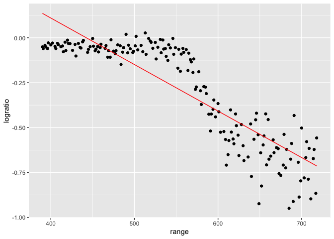
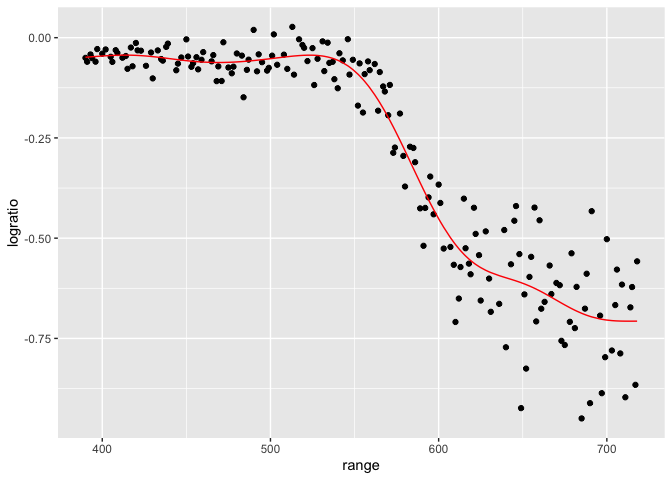
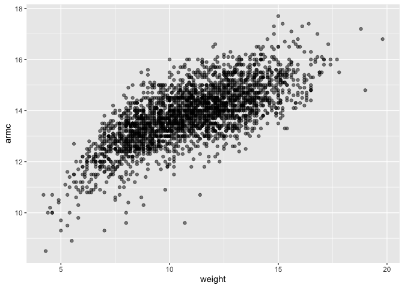
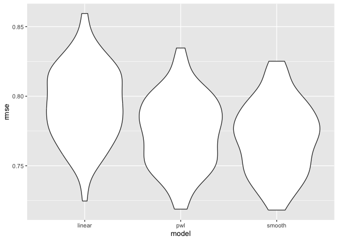

02_cross_validation
================
2026-11-17

``` r
library(tidyverse)
```

    ## ── Attaching core tidyverse packages ──────────────────────── tidyverse 2.0.0 ──
    ## ✔ dplyr     1.2.1     ✔ readr     2.2.0
    ## ✔ forcats   1.0.1     ✔ stringr   1.6.0
    ## ✔ ggplot2   4.0.3     ✔ tibble    3.3.1
    ## ✔ lubridate 1.9.5     ✔ tidyr     1.3.2
    ## ✔ purrr     1.2.2     
    ## ── Conflicts ────────────────────────────────────────── tidyverse_conflicts() ──
    ## ✖ dplyr::filter() masks stats::filter()
    ## ✖ dplyr::lag()    masks stats::lag()
    ## ℹ Use the conflicted package (<http://conflicted.r-lib.org/>) to force all conflicts to become errors

``` r
library(p8105.datasets)
library(modelr)
library(mgcv)
```

    ## Loading required package: nlme
    ## 
    ## Attaching package: 'nlme'
    ## 
    ## The following object is masked from 'package:dplyr':
    ## 
    ##     collapse
    ## 
    ## This is mgcv 1.9-4. For overview type '?mgcv'.

## LIDAR Data

``` r
data("lidar")

lidar_df = 
  lidar |> 
  mutate(id = row_number()) |> 
  select(id, everything())

lidar_df |> 
  ggplot(aes(x = range, y = logratio)) + 
  geom_point()
```

<!-- -->

Building Training and Testing Datasets

``` r
train_df = sample_frac(lidar_df, size = .8)
test_df  = anti_join(lidar_df, train_df, by = "id")
```

``` r
ggplot(train_df, aes(x = range, y = logratio)) + 
  geom_point() + 
  geom_point(data = test_df, color = "red")
```

<!-- -->

Fit Some Models

``` r
linear_mod = lm(logratio ~ range, data = train_df)
smooth_mod = gam(logratio ~ s(range), data = train_df)
wiggly_mod = gam(logratio ~ s(range, k = 30), sp = 10e-6, data = train_df)
```

Make a Plot

``` r
train_df |>
  add_predictions(linear_mod) |>               # shows fitted data points and lines that go through them
  ggplot(aes(x = range, y = logratio)) +
  geom_point() +
  geom_line(aes(y = pred), color = "red")
```

<!-- -->

``` r
train_df |>
  add_predictions(smooth_mod) |>               # smooth_mod [...]
  ggplot(aes(x = range, y = logratio)) +
  geom_point() +
  geom_line(aes(y = pred), color = "red")
```

<!-- -->

Do a Model Comparison

``` r
rmse(linear_mod, test_df)
```

    ## [1] 0.1212343

``` r
rmse(smooth_mod, test_df)
```

    ## [1] 0.06814752

``` r
rmse(wiggly_mod, test_df)
```

    ## [1] 0.07328329

## Repeat Multiple Times

Use Nice Tools

``` r
cv_df =
  crossv_mc(lidar_df, 100)

cv_df |> pull(train) |> nth(2) |> as_tibble()    # `nth()` restores row numbers initially, leaves out 1 and 4 in second instance; gives 80-20 split every time
```

    ## # A tibble: 176 × 3
    ##       id range logratio
    ##    <int> <dbl>    <dbl>
    ##  1     1   390  -0.0504
    ##  2     2   391  -0.0601
    ##  3     3   393  -0.0419
    ##  4     4   394  -0.0510
    ##  5     5   396  -0.0599
    ##  6     7   399  -0.0596
    ##  7     8   400  -0.0399
    ##  8     9   402  -0.0294
    ##  9    10   403  -0.0395
    ## 10    11   405  -0.0476
    ## # ℹ 166 more rows

``` r
cv_df =
  crossv_mc(lidar_df, 100) |>
  mutate(
    train = map(train, as_tibble),
    test = map(test, as_tibble)
  )
```

Let’s Fit Models and Get RMSEs for These

``` r
rmse_comp = function(model, dataset) {
  
  rmse(model, dataset)
  
}
```

``` r
cv_df = 
  cv_df |> 
  mutate(
    linear_fit = map(train, \(df) lm(logratio ~ range, data = df)),
    smooth_fit = map(train, \(df) gam(logratio ~ s(range), data = df)),
    wiggly_fit = map(train, \(df) gam(logratio ~ s(range, k = 30), sp = 10e-6, data = df))
  ) |> 
  mutate(
    rmse_linear = map2_dbl(linear_fit, test, rmse),
    rmse_smooth = map2_dbl(smooth_fit, test, rmse),
    rmse_wiggly = map2_dbl(wiggly_fit, test, rmse)
  )
```

Look at This

``` r
cv_df |>
  select(starts_with("rmse_")) |>
  pivot_longer(
    everything(),
    names_to = "model",
    names_prefix = "rmse_",
    values_to = "rmse"
  ) |>
  ggplot(aes(x = model, y = rmse)) +
  geom_violin()
```

<!-- -->

## Child Growth Example

``` r
growth_df =
  read_csv("data/nepalese_children.csv") |>
  mutate(
    weight_ch7 = (weight > 7) * (weight - 7)
  )
```

    ## Rows: 2705 Columns: 5
    ## ── Column specification ────────────────────────────────────────────────────────
    ## Delimiter: ","
    ## dbl (5): age, sex, weight, height, armc
    ## 
    ## ℹ Use `spec()` to retrieve the full column specification for this data.
    ## ℹ Specify the column types or set `show_col_types = FALSE` to quiet this message.

Look at This

``` r
growth_df    # weight as a predictor
```

    ## # A tibble: 2,705 × 6
    ##      age   sex weight height  armc weight_ch7
    ##    <dbl> <dbl>  <dbl>  <dbl> <dbl>      <dbl>
    ##  1    41     1   12.8   91.2  14.3        5.8
    ##  2    57     2   14.9  104.   13.9        7.9
    ##  3    35     2   12.1   86.4  14.4        5.1
    ##  4    46     1   13.9   96.4  13.5        6.9
    ##  5    26     2    8.7   78.5  12.1        1.7
    ##  6    57     1   12.1   89.9  13.9        5.1
    ##  7    22     1    9.8   79.1  13          2.8
    ##  8    55     1   13.7   92.6  13.6        6.7
    ##  9    20     1   10.1   77.7  14.5        3.1
    ## 10    36     2   11.2   79.8  14.4        4.2
    ## # ℹ 2,695 more rows

``` r
growth_df |>
  ggplot(aes(x = weight, y = armc)) +
  geom_point(alpha = .5)
```

<!-- -->

``` r
linear_fit = lm(armc ~ weight, data = growth_df)
pwl_fit = lm(armc ~ weight + weight_ch7, data = growth_df)
smooth_fit = gam(armc ~ s(weight), data = growth_df)
```

``` r
growth_df |>
  add_predictions(linear_fit) |>               # linear model
  ggplot(aes(x = weight, y = armc)) +
  geom_point(alpha = .5) +
  geom_line(aes(y = pred), color = "red")
```

<!-- -->

``` r
growth_df |>
  add_predictions(pwl_fit) |>                  # piece-wise linar model
  ggplot(aes(x = weight, y = armc)) +
  geom_point(alpha = .5) +
  geom_line(aes(y = pred), color = "red")
```

<!-- -->

Conducting all the CV Covered

``` r
cv_df =
  crossv_mc(growth_df, 100) |>
  mutate(
    train = map(train, as_tibble),
    test = map(test, as_tibble)
  )
```

Fitting Models and Getting RMSEs

``` r
cv_df = 
  cv_df |> 
  mutate(
    linear_fit = map(train, \(df) lm(armc ~ weight, data = df)),
    pwl_fit    = map(train, \(df) lm(armc ~ weight + weight_ch7, data = df)),
    smooth_fit = map(train, \(df) gam(armc ~ s(weight), data = df))
  ) |> 
  mutate(
    rmse_linear = map2_dbl(linear_fit, test, rmse),
    rmse_pwl    = map2_dbl(pwl_fit, test, rmse),
    rmse_smooth = map2_dbl(smooth_fit, test, rmse)
  )
```

Plotting

``` r
cv_df |> 
  select(starts_with("rmse_")) |> 
  pivot_longer(
    everything(),
    names_to = "model",
    names_prefix = "rmse_",
    values_to = "rmse"
  ) |> 
  ggplot(aes(x = model, y = rmse)) + 
  geom_violin()
```

<!-- -->
