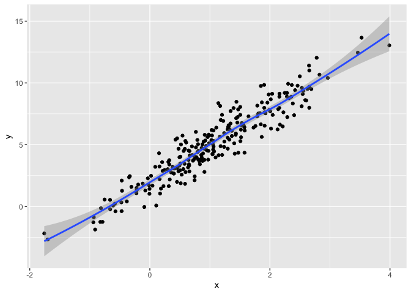
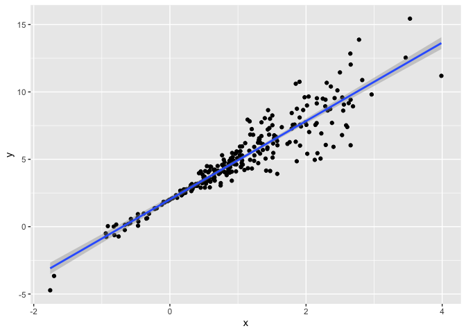
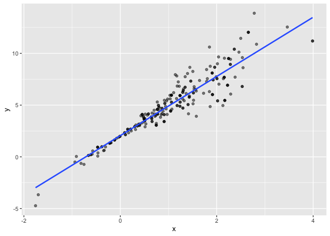
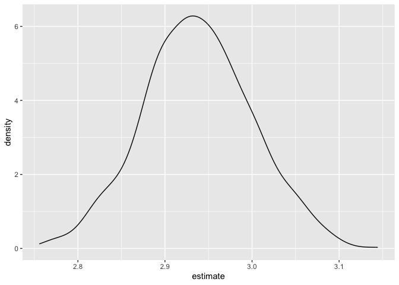
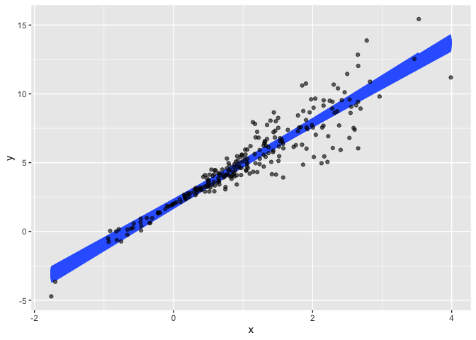
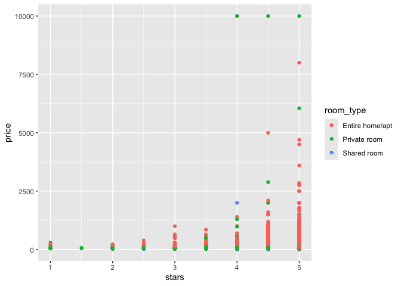
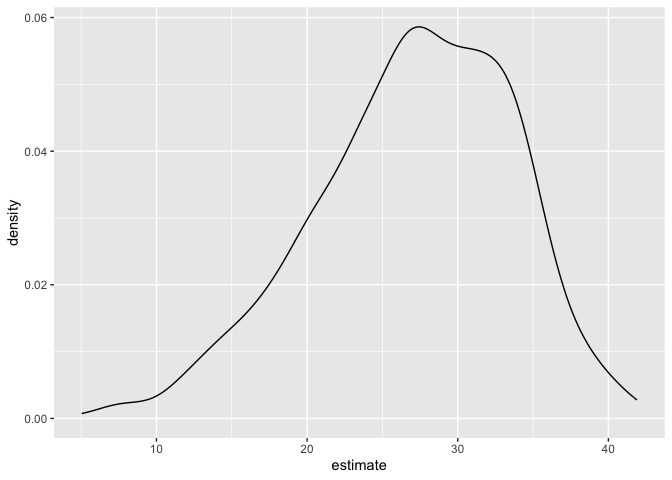

03_bootstrapping
================
2026-11-19

``` r
library(tidyverse)
```

    ## ── Attaching core tidyverse packages ──────────────────────── tidyverse 2.0.0 ──
    ## ✔ dplyr     1.2.1     ✔ readr     2.2.0
    ## ✔ forcats   1.0.1     ✔ stringr   1.6.0
    ## ✔ ggplot2   4.0.3     ✔ tibble    3.3.1
    ## ✔ lubridate 1.9.5     ✔ tidyr     1.3.2
    ## ✔ purrr     1.2.2     
    ## ── Conflicts ────────────────────────────────────────── tidyverse_conflicts() ──
    ## ✖ dplyr::filter() masks stats::filter()
    ## ✖ dplyr::lag()    masks stats::lag()
    ## ℹ Use the conflicted package (<http://conflicted.r-lib.org/>) to force all conflicts to become errors

``` r
library(p8105.datasets)
library(modelr)         # bootstrap(), plus add_predictions() and rmse() from cross-validation
library(mgcv)
```

    ## Loading required package: nlme
    ## 
    ## Attaching package: 'nlme'
    ## 
    ## The following object is masked from 'package:dplyr':
    ## 
    ##     collapse
    ## 
    ## This is mgcv 1.9-4. For overview type '?mgcv'.

``` r
set.seed(1236)          # bootstrapping is random re-sampling; the seed makes every knit identical
```

## Simulated Regression

``` r
n_samp = 250

# Simulated data where the true model is known: intercept of 2, slope of 3

sim_df_const =
  tibble(
    x = rnorm(n_samp, 1, 1),        # 250 x values from a normal distribution (mean = 1, sd = 1)
    error = rnorm(n_samp, 0, 1),    # errors with constant variance (sd = 1 everywhere)
    y = 2 + 3 * x + error
  )

# Same x values, but the errors now scale with x: nonconstant variance, which violates a key assumption of linear regression

sim_df_nonconst =
  sim_df_const |>
  mutate(
    error = error * .75 * x,
    y = 2 + 3 * x + error
  )
```

Plot Some Data

``` r
sim_df_const |>                 # spread around the line is about the same everywhere
  ggplot(aes(x = x, y = y)) +
  geom_point() +
  geom_smooth()
```

    ## `geom_smooth()` using method = 'loess' and formula = 'y ~ x'

<!-- -->

``` r
sim_df_nonconst |>              # note that there's almost no variability when x is close to 0, and more as x moves away from 0
  ggplot(aes(x = x, y = y)) +
  geom_point() +
  geom_smooth(method = "lm")
```

    ## `geom_smooth()` using formula = 'y ~ x'

<!-- -->

Fit the Regressions

``` r
# Estimates should be close to the true values (2 and 3); the standard errors assume constant variance

sim_df_const |>
  lm(y ~ x, data = _) |>
  broom::tidy() |>
  knitr::kable(digits = 3)
```

| term        | estimate | std.error | statistic | p.value |
|:------------|---------:|----------:|----------:|--------:|
| (Intercept) |    2.021 |     0.094 |    21.547 |       0 |
| x           |    2.941 |     0.066 |    44.352 |       0 |

An example of nonconstant regression:

``` r
# Similar estimates, but `lm()` still calculates standard errors as if the variance were constant, so they may be wrong. Bootstrapping gives a way to check.

sim_df_nonconst |>
  lm(y ~ x, data = _) |>
  broom::tidy() |>
  knitr::kable(digits = 3)
```

| term        | estimate | std.error | statistic | p.value |
|:------------|---------:|----------:|----------:|--------:|
| (Intercept) |    2.022 |     0.102 |    19.765 |       0 |
| x           |    2.909 |     0.072 |    40.220 |       0 |

## Draw a Bootstrap Sample

Always write a little function

``` r
draw_boot_sample = function(df) {
  
  sample_frac(df, replace = TRUE)  # same number of rows as the original, drawn WITH replacement: some rows appear more than once and others not at all, so each sample is different
    
}
```

Does this work?

``` r
sim_df_nonconst |>
  draw_boot_sample() |>
  ggplot(aes(x = x, y = y)) +
  geom_point(alpha = .5) +                  # repeated rows overlap, so they show up as darker points
  geom_smooth(method = "lm", se = FALSE)
```

    ## `geom_smooth()` using formula = 'y ~ x'

<!-- -->

## Draw Multiple Samples and Analyze

``` r
boot_strap_df =
  tibble(
    strap_number = 1:1000          # one row per bootstrap sample
  ) |>
  mutate(
    strap_sample = map(strap_number, \(i)draw_boot_sample(sim_df_nonconst)),   # `\(i)` lets `map()` run `draw_boot_sample()` once per row; i (the strap number) is taken as input but not used fit the regression to each bootstrap sample
    model_fit = map(strap_sample, \(df) lm(y ~ x, data = df)),                 
    results = map(model_fit, broom::tidy)                                      # tidies each model's coefficient table
  )
```

``` r
# Same process for the constant-variance data. Note: this overwrites `boot_strap_df` from the chunk above

boot_strap_df =
  tibble(
    strap_number = 1:1000
  ) |>
  mutate(
    strap_sample = map(strap_number, \(i)draw_boot_sample(sim_df_const)),   # `\(i)` lets `map()` run draw_boot_sample() once per row; i is not used
    model_fit = map(strap_sample, \(df) lm(y ~ x, data = df)),
    results = map(model_fit, broom::tidy)
  )
```

Does this work?

``` r
boot_strap_df |>
  select(strap_number, results) |>
  unnest(results) |>                  # one row per bootstrap sample x term
  group_by(term) |>
  summarize(
    mean_est = mean(estimate),        # average estimate across the 1,000 samples
    se_est = sd(estimate)             # the SD of the estimates IS the bootstrap standard error; compare it with the std.error column from `lm()` above
  )
```

    ## # A tibble: 2 × 3
    ##   term        mean_est se_est
    ##   <chr>          <dbl>  <dbl>
    ## 1 (Intercept)     2.02 0.0846
    ## 2 x               2.94 0.0627

``` r
boot_strap_df |> 
  select(strap_number, results) |> 
  unnest(results) |> 
  filter(term == "x") |>              # keeps only the slope
  ggplot(aes(x = estimate)) + 
  geom_density()                      # the bootstrap distribution of the slope estimate
```

<!-- -->

## Look at the Results Further

``` r
# Each line is the regression fit from one bootstrap sample; the spread of the lines
# shows the uncertainty in the fitted line, layered over the original data points

boot_strap_df |>
  select(strap_number, strap_sample) |>
  unnest(strap_sample) |>
  ggplot(aes(x = x, y = y, group = strap_number)) +                   # group = strap_number draws one line per sample
  geom_smooth(method = "lm", se = FALSE, alpha = .3) +
  geom_point(data = sim_df_nonconst, aes(group = NULL), alpha = .6)   # original data; group = NULL removes the grouping for this layer
```

    ## `geom_smooth()` using formula = 'y ~ x'

<!-- -->

### Quick Notes

``` r
# `modelr::bootstrap()` is a shortcut for the custom function + `map()` approach above: it creates 1,000 bootstrap samples in a `strap` column, with an `.id` column numbering them

boot_straps =
  sim_df_nonconst |>
  modelr::bootstrap(n = 1000)
```

## Revisiting the Airbnb Example

``` r
data("nyc_airbnb")

nyc_airbnb = 
  nyc_airbnb |> 
  mutate(stars = review_scores_location / 2) |> 
  rename(
    borough = neighbourhood_group,
    neighborhood = neighbourhood) |> 
  filter(borough != "Staten Island") |> 
  drop_na(price, stars) |>                                # removes rows missing either model variable
  select(price, stars, borough, neighborhood, room_type)
```

This Doesn’t Look Good

``` r
nyc_airbnb |>                                              # prices are heavily skewed with extreme outliers, so lm()'s usual standard errors may not be trustworthy
  ggplot(aes(x = stars, y = price, color = room_type)) +
  geom_point()
```

<!-- -->

### Bootstrapping the Data

``` r
airbnb_bootstrap_df =
  nyc_airbnb |>
  filter(borough == "Manhattan") |>
  modelr::bootstrap(n = 1000) |>                                              # 1,000 bootstrap samples of the Manhattan listings
  mutate(
    model_fit = map(strap, \(df) lm(price ~ stars + room_type, data = df)),   # `lm()` can use the resample objects directly
    results = map(model_fit, broom::tidy)
  )
```

Are these coefficients close enough to Normal that I can trust default
inference?

``` r
airbnb_bootstrap_df |>         # We should not assume this follows a normal distribution: it's skewed
  select(results) |>
  unnest(results) |>
  filter(term == "stars") |>
  ggplot(aes(x = estimate)) +
  geom_density()
```

<!-- -->

### CI for Stars Slope

``` r
# Percentile bootstrap CI: the middle 95% of the 1,000 slope estimates.
# This doesn't assume a normal distribution, unlike lm()'s default confidence interval

airbnb_bootstrap_df |>
  select(results) |>
  unnest(results) |>
  filter(term == "stars") |>
  summarize(
    slope_estimate = mean(estimate),
    ci_lb = quantile(estimate, 0.025),   # lower bound: 2.5th percentile
    ci_ub = quantile(estimate, 0.975)    # upper bound: 97.5th percentile
  )
```

    ## # A tibble: 1 × 3
    ##   slope_estimate ci_lb ci_ub
    ##            <dbl> <dbl> <dbl>
    ## 1           27.0  12.9  38.3
